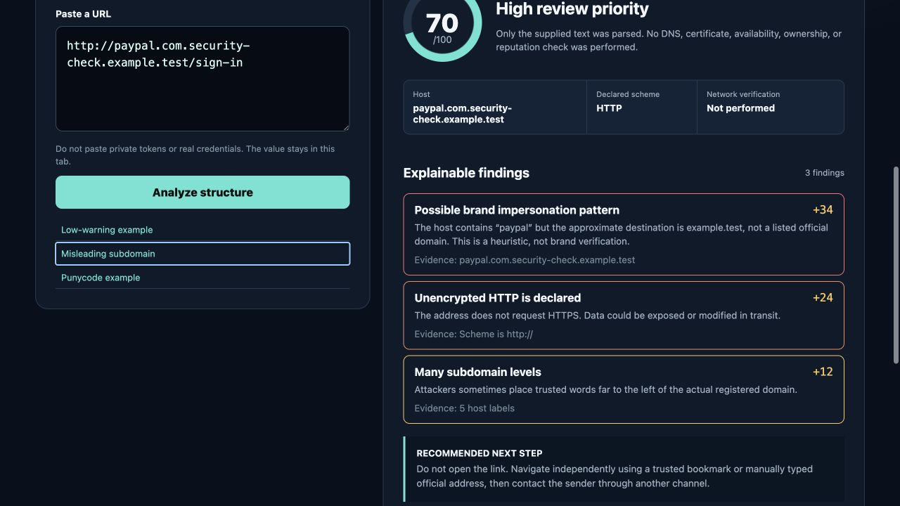

# PhishGuard



PhishGuard is a local, explainable URL-structure analyzer for defensive phishing
triage. It helps a user slow down and inspect an address without automatically
opening it. The score prioritizes review; it does **not** claim that a URL is
verified phishing or verified safe.

## Problem addressed

Misleading subdomains, embedded credentials, Punycode, IP hosts, heavy encoding,
and trusted brand words can make a destination difficult to read. Opening the
URL just to investigate it creates risk. PhishGuard separates text analysis
from remote verification.

## Features

- URL parsing without navigation or network requests
- Misleading-subdomain and possible brand-impersonation warnings
- Punycode, Unicode, IP-host, credential, encoding, port, and download-path checks
- Explainable 0–100 review-priority score
- Clear separation of facts, heuristics, and checks not performed
- Synthetic `.test` examples and accessible responsive dashboard
- Seven automated tests and GitHub Actions

## Architecture and stack

The project is a static HTML/CSS/JavaScript application. `analyzer.js` is a pure
function that returns facts, findings, a score, and a recommendation. `app.js`
renders the model without using `innerHTML`, which avoids turning supplied text
into page markup. There are no runtime dependencies, analytics, cookies, or
external APIs.

## Run locally

```bash
python3 -m http.server 8000
```

Open `http://127.0.0.1:8000`. Use the included synthetic examples rather than
real links containing private data.

## Test

```bash
npm test
```

Verified result for this release: **7 tests passed**. The tests cover invalid
schemes, HTTPS wording, brand-like subdomains, Punycode, embedded credentials,
download paths, and score bounding.

## Security principles and threat model

The main principle is non-navigation: submitted URLs are treated as untrusted
text. See [SECURITY.md](SECURITY.md). The tool does not verify DNS, TLS,
ownership, availability, reputation, redirects, or page content. Structure
alone cannot establish safety.

## Future improvements

- Offline Public Suffix List support for more accurate registered domains
- A larger, transparently sourced brand-domain mapping
- Optional user-approved, privacy-preserving reputation checks kept separate
  from the default local analysis
- More internationalized-domain test cases and accessibility automation

## AI-assisted development disclosure

OpenAI Codex generated the initial application, tests, interface, and
documentation. The repository owner must review, understand, and modify the
work before describing personal technical contributions. No independent coding
claim, user count, security impact, or deployment statistic is implied.

## License

[MIT](LICENSE)
